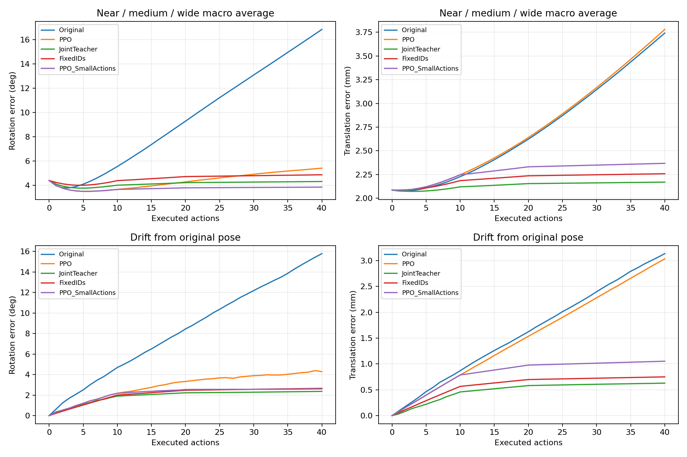
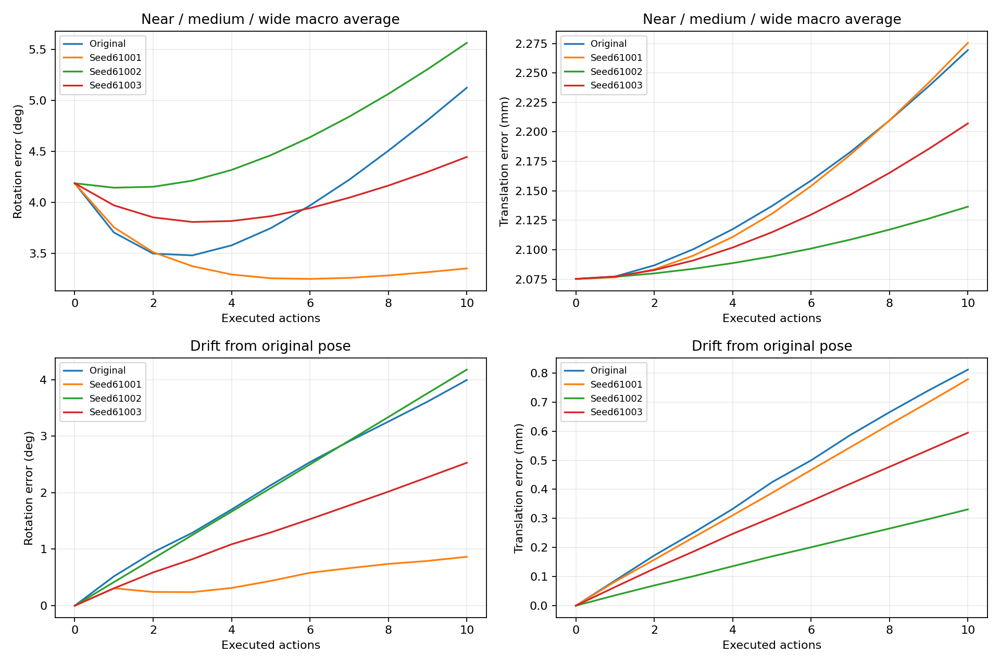
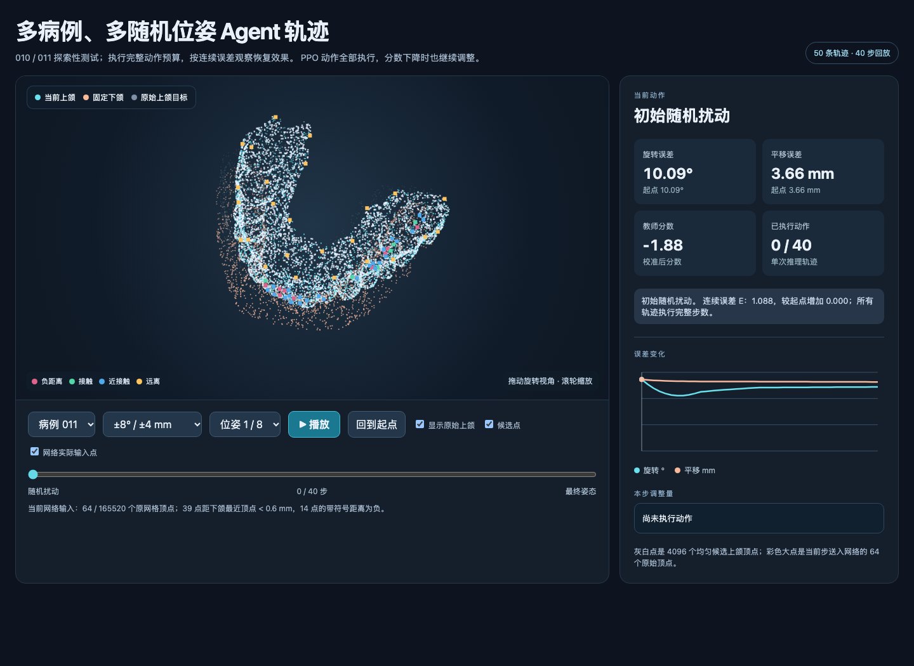

# 连续误差优化实验：2026-10-01

本轮把角度、平移误差作为连续指标，不再以 1.5°/0.5 mm 判定模型是否有效。所有 agent 均执行完整预算，没有 STOP、精度触发的提前结束或降分动作回退。实验目录为 `runs/optimization_20261001/`，原始权重及 STL 保留。

## 已完成的方法与验证

- 固定原训练/验证/测试划分；核对 22 个 STL、原始 teacher/agent 权重及 manifest 的 SHA-256，记录到 `input_fingerprints.json`。
- 增加 rotvec 固定起点库，按病例 ID、档位与种子生成，增加样本数时前缀不变。连续评价量为 `E = 0.5 × (角度/8° + 平移/4 mm)`，病例与近/中/远档等权；零姿态漂移单独统计。
- 记录完整轨迹、实际初始矩阵、teacher 分数、动作、接触比例和距离；分别检查 10/20/40 步。多 horizon 的结果是最长轨迹的前缀；带时间输入的新策略会感知该最长预算，因此其 10 步前缀不应混同于单独执行 10 步的结果。
- 候选点只做必要的刚体变换，下颌最近点查询批量计算；测试确认与原有全网格变换的输入逐项一致。
- 新 teacher 使用 rotvec、原始姿态样本、局部与跨方向姿态对、连续回归、按质量差调整 margin，以及候选种子一致性损失。输入仍是原始顶点、顶点法向、拓扑曲率和带符号最近下颌顶点距离。
- 新 PPO 使用有限预算末步零 bootstrap、gamma=1、正比例缩放的有符号 teacher 分数差、小幅 actor 初始化、时间输入、编码器分组学习率/冻结、连续误差选模及 KL/clip/value/action 日志。真值只用于生成 teacher 监督目标及 agent 验证，不进入 agent 奖励或观测。
- 冻结编码器时缓存编码结果，减少 PPO 重复前向；测试验证策略梯度与未缓存版本一致。
- 增加 teacher/agent 采样配置校验，新保存的 agent 支持冻结 teacher 权重哈希校验；推理栈支持时间输入和动作阶段。

## 采样诊断

验证病例 001/006，各自从零、近、宽三个实际起点做六轴正负微扰（0.05°/0.01 mm）。同一 teacher 权重下的敏感性结果：

| 方法 | 平均选点更换率 | 分数变化绝对值 p95 | 接触点比例 |
| --- | ---: | ---: | ---: |
| 当前动态接触配额 FPS | 20.1% | 0.190 | 65.3% |
| 取消配额，动态加权 FPS | 23.3% | 0.271 | 26.5% |
| 从实际起点选点，轨迹内固定 ID | 0% | 0.029 | 64.4% |

取消配额并未改善稳定性，故未扩大该分支。固定 ID 的选点完全来自实际扰动输入，不使用正确姿态；后续保留这些原顶点并更新位置、法向和距离。它是新采样实验，必须匹配 teacher/agent 训练，不能直接把旧权重的敏感性测试当成重训效果。

## Teacher 对照结果

训练库为 7 例、每例 256 个三元组；验证库为 2 例、每例 192 个三元组。三元组含当前姿态、比较姿态、同姿态不同候选种子的输入；验证第三项为真实微扰。姿态库缓存后重复训练，不是每轮新增独立姿态。两阶段原始 teacher 指标来自这个新验证库，不能与旧报告不同分布的 MAE 直接比较。

| 方案 | 最佳轮次 | MAE | 近区比较准确率 | 微扰差分 MAE |
| --- | ---: | ---: | ---: | ---: |
| 原 calibration teacher，动态输入 | — | 0.565 | 62.7% | 0.0733 |
| Ranking 仅正斜率线性标定 | — | 0.456 | 68.3% | 0.0335 |
| 回归 + ranking，动态输入 | 6 | 0.358 | 65.8% | 0.0512 |
| 上组 + 采样一致性 | 12 | 0.348 | 70.8% | 0.0408 |
| 原 teacher，固定 ID 输入（未重训诊断） | — | 0.565 | 73.3% | 0.0073 |
| 固定 ID 匹配训练 + 一致性 | 12 | 0.350 | 82.0% | 0.0075 |

固定 ID agent 使用的是训练期间冻结并单独保存的第 9 轮 `teacher_fixed/agent_source.pt`（MAE 0.356，近区 80.7%）。该文件不随后续 teacher 最佳轮次更新；agent 实际使用权重与最终 teacher 最佳权重分别报告，避免混淆。

Teacher-only 搜索在每例每档 4 个起点上执行 10 轮、每轮评估零动作及正负六轴动作，共每轨迹 131 次 teacher 调用，6 个病例/档位组合的平均 E 均有所下降，但幅度有限。这是评分可优化性诊断；其候选选择与零动作不进入 PPO，计算量也不能和一次策略前向等同。

## Agent 训练分组

| 名称 | Teacher / 采样 | 动作与训练预算 |
| --- | --- | --- |
| 原 agent | 原 teacher / 动态 FPS | 原 10 步 PPO |
| control | 原 teacher / 动态 FPS | 改进 PPO，10 步，每个种子 13,440 交互预算 |
| scheduled | 新一致性 teacher / 动态 FPS | 10 步粗调 + 10 步细调，13,440 交互 |
| fixed | 新固定 ID teacher / 固定 ID | 同上，13,440 交互 |
| fixed_frozen | 同上，冻结编码器 | 50,400 步预算，验证早停于 33,600 交互 |

control 先冻结编码器 28 轮，然后以较低学习率微调；scheduled/fixed 冻结 14 轮。所有组初始 log_std=-1，唯一环境奖励为 `2 × (score_next - score_current)`，没有姿态误差奖励、动作惩罚、只保留正奖励或动作接受门控。

fixed_frozen 在第 35 轮达到早期最佳，之后连续五次检查未改善而结束训练。每条轨迹仍完整执行 20 步。其结果表明“更平滑的评分 + 更多 PPO”不足以保证恢复效果，不据此继续扩大到 20 万步。

## 连续误差与多种子结果

验证 001/006 每例每个非零档 32 个相同起点，初始宏平均为 **4.400° / 2.085 mm，E=0.5356**。下表均执行 40 步；10 步列为该长预算的前缀。

| 方案 | 第 10 步角度 / 平移 | 第 40 步角度 / 平移 | 第 40 步 E |
| --- | --- | --- | ---: |
| 原 agent | 5.559° / 2.227 mm | 16.854° / 3.742 mm | 1.5211 |
| 改进 PPO，原 teacher | 3.666° / 2.247 mm | 5.421° / 3.780 mm | 0.8113 |
| 新一致性 teacher，粗细动作训练 | 4.018° / 2.119 mm | 4.321° / 2.169 mm | 0.5412 |
| 新固定 ID teacher，粗细动作训练 | 4.392° / 2.185 mm | 4.875° / 2.258 mm | 0.5869 |
| 改进 PPO，仅推理时加入粗细动作 | 3.666° / 2.247 mm | 3.858° / 2.367 mm | 0.5371 |

最后一组沿用 10 步训练权重，推理时前 10 步 2°/0.4 mm、接着 10 步 0.5°/0.1 mm、之后 0.1°/0.02 mm。阶段上限是每轴动作缩放，实际连续动作由 agent 输出；40 步以后最后一级仍非零。该组验证了减小后段动作可以减少漂移，**没有证明更多动作持续改善恢复**。新 teacher 组同时更改了训练 horizon，不能把组间差异全部归因于 teacher。



原 teacher + 改进 PPO 的三个独立训练种子，每个均完成 168 轮、13,440 交互；按每例每档 8 个固定验证起点、独立 10 步预算选模。该验证集初始 E=0.5293。

| 种子 | 最佳轮次 | 角度 | 平移 | E |
| --- | ---: | ---: | ---: | ---: |
| 61001 | 140 | 3.475° | 2.180 mm | 0.4897 |
| 61002 | 28 | 5.646° | 2.099 mm | 0.6153 |
| 61003 | 56 | 4.349° | 2.106 mm | 0.5351 |

三种子 E 均值 ± 样本标准差为 **0.5467 ± 0.0636**。只有首个种子改善初始综合误差，且仍恶化平移。首个种子 PyTorch 使用 4 线程，后两个使用 1 线程以降低并行训练开销；优化目标和交互预算相同，但这不是完全相同计算后端下的严格种子方差估计。三个种子的各自最佳权重都保留。

冻结编码器扩量分支的最佳验证 E=0.5241，仍有平移恶化；后续训练退化。首个 control 在 7 个训练病例的新起点上也只有角度改善（4.407°→4.083°），平移 2.082→2.257 mm，E 0.5357→0.5373，而 teacher 分数提升 0.389。**问题不仅是新病例泛化，teacher 的优化方向与恢复误差仍未充分一致。**

已在读取测试输出前写入 `runs/optimization_20261001/selection.json`，锁定 control/61001 第 140 轮作为本轮探索性对照，不把它称为稳定恢复模型。`configs/optimization_selected.json` 指向对应原 teacher 和 agent；40 步演示是同权重的推理动作尺度消融。

## 010/011 探索性测试

每例近/中/远各 128 个固定起点，合计 **768 个随机起点 + 2 个零姿态**，全部执行 10 步。模型选择记录锁定后才读取这些结果。原 agent 与三个训练种子逐条核对初始旋转/平移完全一致。

| 方案 | 平均角度 | 平均平移 | E | 全顶点位移 RMS |
| --- | ---: | ---: | ---: | ---: |
| 初始扰动 | 4.187° | 2.075 mm | 0.5211 | 2.504 mm |
| 原 agent | 5.123° | 2.269 mm | 0.6039 | 3.038 mm |
| 改进 PPO，61001（验证选定） | **3.352°** | 2.276 mm | **0.4939** | 2.576 mm |
| 改进 PPO，61002 | 5.563° | 2.137 mm | 0.6148 | 2.960 mm |
| 改进 PPO，61003 | 4.444° | 2.207 mm | 0.5537 | 2.743 mm |

选定种子的角度比起点减少 0.835°，但平移增加 0.200 mm；70.7% 起点的角度改善，30.3% 的平移改善。分数平均上升 0.452，仍有 **30.6% 起点出现分数上升而 E 变差**。三个种子的测试 E 为 **0.5541 ± 0.0604**（样本标准差），总体高于初始误差。全顶点 RMS 也没有改善初始值，因此不能把 E 的小幅下降解释为整体几何恢复已经可靠。

选定种子的分例分档结果：

| 病例 / 档位 | 初始角度 / 平移 | 最终角度 / 平移 |
| --- | --- | --- |
| 010 近 | 1.470° / 0.499 mm | 1.244° / 0.951 mm |
| 010 中 | 3.797° / 1.889 mm | 3.224° / 2.003 mm |
| 010 远 | 7.312° / 3.840 mm | 6.055° / 3.927 mm |
| 011 近 | 1.441° / 0.493 mm | 1.255° / 0.896 mm |
| 011 中 | 3.802° / 1.908 mm | 2.767° / 2.024 mm |
| 011 远 | 7.298° / 3.823 mm | 5.566° / 3.851 mm |

从正确姿态出发，010 最终漂移 **0.795° / 0.800 mm**，011 为 **0.937° / 0.757 mm**；旧 agent 分别为 4.046°/0.860 mm、3.942°/0.764 mm。角度漂移减少，平移漂移基本未解决，近档尤为明显。

分组角度 p90 的宏平均从旧 agent 的 7.912°降到 5.063°，平移 p90 从 3.155 mm 增到 3.265 mm。选定种子全顶点 RMS 为 2.576 mm；4096 个均匀候选顶点的位移 p95 宏平均为 3.422 mm（初始 3.499 mm）。RMS 按全部原网格顶点精确计算；p95 按候选顶点估计，均非表面积加权。上述 p90/中位数是先分病例/档位计算再宏平均，不能当成所有样本混合后的分位数。逐组原始值保存在 `test_geometry_summary.json`。



另以每例每档 32 个相同起点测试推理粗细动作 40 步：起点 4.058°/2.066 mm，第 10 步 3.222°/2.262 mm，第 20 步 3.321°/2.351 mm，第 40 步 3.363°/2.389 mm。E 从初始 0.5118 到第 10 步 0.4841，再回升到第 40 步 0.5088。后段动作确实在执行，但仍缓慢漂移；不能以此宣称“持续动作越多误差越小”。这些 10 步前缀的时间上下文和起点数量与上面的独立 10 步测试不同。

**本轮结论：** 采样一致性和固定 ID 能改善部分 teacher 指标；新的 PPO 减少了首个种子的角度误差和旧策略的大幅漂移。平移恢复、近区稳定性、多种子复现仍未达成，不能将新 teacher/agent 默认替换为已验证的最终方案。本轮权重、失败分支和完整轨迹均保留，后续优先改善实际可达姿态上的 teacher 局部方向判断。

## 复现入口

```bash
# 新 teacher；三种模式使用同一动态采样姿态库
.venv/bin/python -m occlusion_rl_offline.joint_teacher \
  --config configs/optimization_20261001.json \
  --out runs/optimization_20261001/teacher_consistent \
  --bank-dir runs/optimization_20261001/teacher_banks --mode consistent

# 保留原 teacher 的 PPO 对照
.venv/bin/python -m occlusion_rl_offline.optimized_ppo \
  --config configs/optimization_ppo_control.json \
  --teacher runs/data11_contact_fps/teacher/calibration/best.pt \
  --out runs/optimization_20261001/agent_control

# 同起点完整轨迹评估
.venv/bin/python -m occlusion_rl_offline.evaluation \
  --config configs/optimization_ppo_control.json \
  --teacher runs/data11_contact_fps/teacher/calibration/best.pt \
  --agent runs/optimization_20261001/agent_control/agent.pt \
  --split val --episodes 32 --horizons 10 20 40 \
  --out runs/optimization_20261001/control_val.json

.venv/bin/python -m unittest discover -s tests -p 'test_continuous_training.py' -v
```

`teacher.trainer=joint` 时，统一 CLI 的 `train-teacher` 调用联合训练；`agent.trainer=continuous` 时 `train-agent`、`evaluate-agent` 调用新栈。所有实验配置可显式指定输出目录；已有缓存若与配置不符会报错，应使用新的实验目录，不能绕过检查混用输入。

本轮新增的主要配置入口：

| 字段 | 作用 |
| --- | --- |
| `model.sampling_mode` | `dynamic` 或从实际起点选点的 `episode_fixed` |
| `optimization.teacher` | 固定姿态库规模/比例、局部微扰、rank margin、回归参数及排序/一致性权重、验证选模权重 |
| `agent.finite_horizon`、`gamma`、`gae_lambda` | 完整预算末步价值与优势估计 |
| `agent.time_context` | 输入已执行/剩余预算比例；需匹配策略权重 |
| `agent.freeze_encoder_iterations`、`encoder_learning_rate` | 冻结时长及编码器微调速度 |
| `agent.actor_init_gain`、`initial_log_std` | 初始动作均值尺度及探索噪声 |
| `agent.action_schedule` | 按动作序号切换粗细尺度，不读取真实误差 |
| `agent.error_scales`、`validation_seed` | 连续误差选模尺度及固定验证起点 |
| `agent.target_kl`、`early_stopping_checks` | PPO 更新限制及训练验证早停；不截断控制轨迹 |

生成本轮持续动作演示：

```bash
.venv/bin/python demo/generate_multi_pose.py \
  --config configs/optimization_control_long_rollout.json \
  --teacher runs/data11_contact_fps/teacher/calibration/best.pt \
  --agent runs/optimization_20261001/agent_control/agent.pt \
  --examples-per-band 8 --seed 426101 --out demo/optimized_data.js
```

打开 [demo/optimized.html](../demo/optimized.html)，默认展示 011 远档第 1 个固定起点，可切换 010/011、零/近/中/远和位姿编号，共 50 条完整 40 步轨迹。此处的 8 个起点是固定库前缀，并未按成功程度筛选。目标上颌只用于演示叠加，不送入 agent。



验证包括：4 项数学/采样/梯度回归测试、配置加载和 Python 编译、统一 CLI 推理、JavaScript 语法、Chrome 无界面实际渲染及截图；全部 2,050 帧的采样坐标与原始网格 ID/刚体变换核对通过，所有 2,000 个动作都有效且执行。几何汇总工具的全顶点 RMS 公式也与逐点计算核对一致。

## 限制

当前只有 7 个训练病例和 2 个验证病例。010/011 已在历史实验中反复用于分析，后续结果属于探索性回归，不是全新病例泛化证明。没有新增独立患者，也没有独立专家咬合标签，因此不声称临床咬合质量已被验证。

新 teacher 的训练库重点覆盖零/近/中/初始宽范围，未新增更大可达状态的回放，固定 ID 样本也未覆盖所有长轨迹历史。这些分布限制可能影响 agent 访问状态上的评分，应作为后续 teacher 数据设计项。改善全局 MAE 或局部比较准确率，不等于 teacher 在整个 agent 轨迹上都给出可靠方向。

本轮是受限预算的筛选：共完成 6 次 PPO 训练、100,800 次训练交互（不含验证/测试），未穷举学习率/探索噪声，也未展开 FPS128/256 和新患者实验。Teacher 的近区成对准确率仍未达到计划中的研发门槛；这些 PPO 分支用于定位问题，不能宣称已经在合格评分器上完成最终优化。后续应优先收集实际 rollout 访问的状态，加入原始姿态与局部六轴/跨方向困难对，核对法向和原始咬合标签；在同一 teacher、相同 horizon 下再做严格单因素 PPO 对照。病例身份/临床标签核验和跨来源泛化仍待新增资料。
